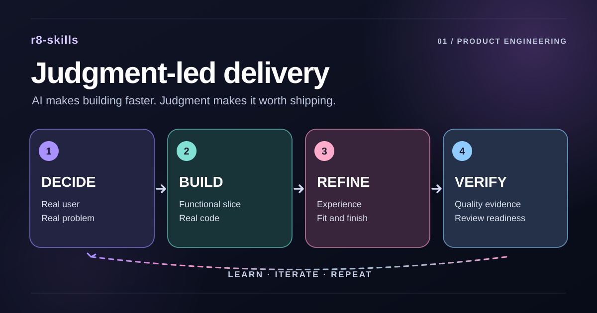
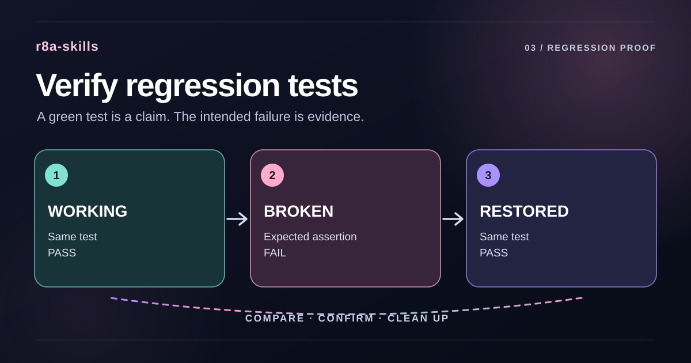

# r8a-skills

**A collection of reusable Agent Skills for coding agents.**

Three focused skills for moving from a useful change to trustworthy delivery. They work with Codex, Claude Code, and other compatible coding agents. Install one when it fits, or install the collection.

## Start here

Use the skills as a simple delivery flow:

1. **Decide what to build** with [`judgment-led-delivery`](skills/judgment-led-delivery/README.md): clarify product scope, build the requested experience, and assess the complete user journey.
2. **Verify the delivery** with [`verified-delivery`](skills/verified-delivery/README.md): gather evidence from the implemented diff, review it proportionately to risk, and prepare it for human review.
3. **Prove a regression test** with [`verify-regression-tests`](skills/verify-regression-tests/README.md), when a changed or existing regression test needs proof that it catches the specific behavior it protects.

The third step is optional: use it for important regression coverage, not every routine change. Each skill has a narrow role, so none replaces the others.

## Skills in this collection

### [Judgment-led delivery](skills/judgment-led-delivery/README.md)



**Build what's worth building. Know when not to.**

Helps coding agents assess whether a product change is useful before implementing it. The skill examines existing behavior, weighs meaningful alternatives, builds working interactions when appropriate, and verifies the user experience against actual evidence. It adapts to the task instead of requiring a heavyweight process.

### [Verified delivery](skills/verified-delivery/README.md)


**Prove a change works before asking someone to merge it.**

Helps coding agents turn an implemented diff into evidence-backed, review-ready delivery. It selects risk-sensitive verification, validates independent review findings, limits review-and-fix work to three rounds, and documents rollback readiness and required approval. It complements Judgment-led delivery rather than repeating product discovery or implementation guidance.

### [Verify regression tests](skills/verify-regression-tests/README.md)



**Prove a test detects the regression it claims to prevent.**

Helps coding agents prove that regression tests detect the behavior they claim to protect. It safely breaks a named production behavior in an isolated copy and requires an assertion-level failure before calling that coverage proof. It complements both delivery skills with focused regression-test evidence.

## Install the collection

Install **all skills** in this repository globally for Codex and Claude Code:

```bash
npx skills add rafa-ochoa/r8a-skills -g -a codex -a claude-code -y
```

Requires Node.js 22.20 or later. The command selects Codex and Claude Code directly, so there is no agent-selection screen.

- Remove `-g` to install only in the current project.
- Change the `-a` values to target different supported agents.
- To install **one skill**, use the command in that skill's README.

## Update installed skills

Update all globally installed skills, including those from this collection:

```bash
npx skills update -g -y
```

This command also updates skills from other repositories. To update a single skill, use the command in its README.

## Get started

Open a project in your coding agent and begin with the skill that matches the work. For example:

> Use judgment-led-delivery to add a favorites feature using the existing UI patterns. Implement the complete interaction and verify its behavior.

After implementation, ask for evidence with:

> Use verified-delivery to verify this change before review. Do not merge.

Use `verify-regression-tests` only when you need to establish that a particular regression test would catch the bug it claims to prevent.

## Contribute

Skills are organized under `skills/`. See [CONTRIBUTING.md](CONTRIBUTING.md) for how to propose one.

[MIT License](LICENSE)
