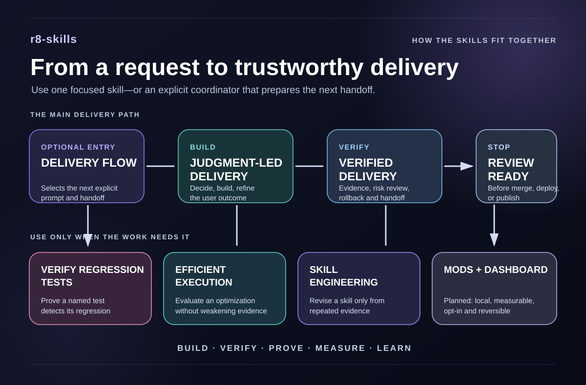
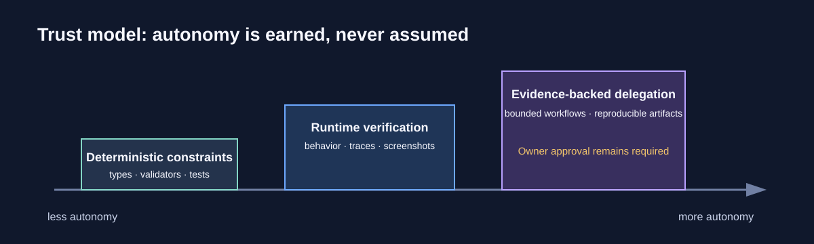
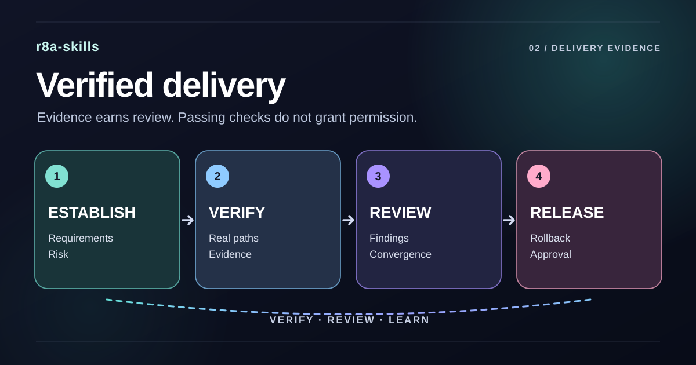
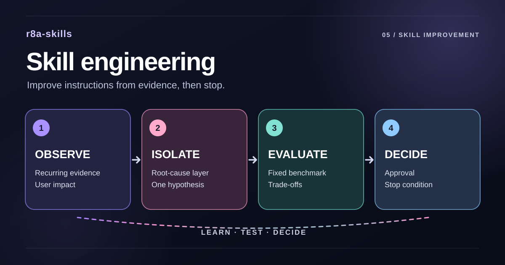
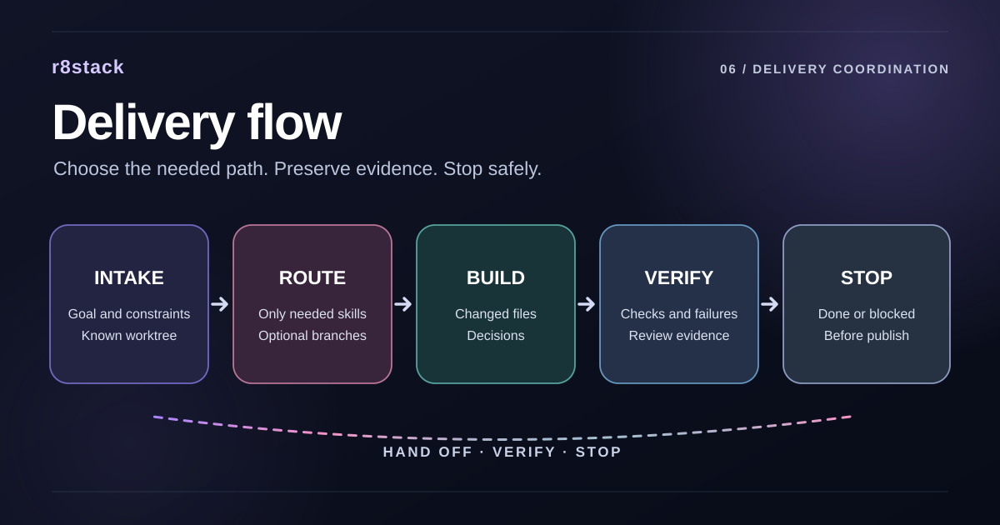

# r8stack

**An engineering system for AI agents: judgment, enforceable guardrails, real verification, and measured learning.**

`r8stack` is deliberately not a software factory that auto-publishes work: agents execute scoped work, the system makes quality checks enforceable, and humans retain approval over consequential actions.

Seven focused skills help coding agents build useful changes, establish real evidence, prevent repeated failures, and stop safely. They work with Codex, Claude Code, and other compatible coding agents. Install one when it fits, or install the collection.


The solid components in the diagram are available in this repository today. The opt-in evaluation comparison runner now checks fixed, repeated baseline/candidate observations; agent-provider adapters remain deliberately out of scope until they can preserve complete evidence. The learning policy, versioned evaluation format, and human approval gate are documented and enforced by the catalog.

## How the skills fit together



The main path is deliberately small:

1. Build the user outcome with [`judgment-led-delivery`](skills/judgment-led-delivery/README.md).
2. Establish evidence with [`verified-delivery`](skills/verified-delivery/README.md).
3. Stop before merging, deploying, publishing, or changing host configuration unless the owner explicitly authorizes it.

Use the supporting skills only for their narrow jobs:

- [`verify-regression-tests`](skills/verify-regression-tests/README.md) proves a named test catches the behavior it protects.
- [`efficient-execution`](skills/efficient-execution/README.md) evaluates an optimization without weakening delivery evidence.
- [`skill-engineering`](skills/skill-engineering/README.md) decides whether repeated evidence justifies improving a skill.
- [`enforceable-guardrails`](skills/enforceable-guardrails/README.md) turns an attributable recurring failure into a narrowly scoped check at its root cause.
- [`delivery-flow`](skills/delivery-flow/README.md) is an explicit coordinator: it prepares the next prompt and handoff, but does not load or run other skills automatically.

For meaningful-risk changes, keep a reproducible feature map: exact revision, user-observable flows, verification commands, and available traces or screenshots. The included validator checks its structure without claiming that its recorded commands ran. Start with [`examples/feature-map.json`](examples/feature-map.json):

```bash
node scripts/validate-feature-map.mjs path/to/feature-map.json
```

## Claude Code workflow and Mods

Read [the Claude execution workflow](docs/claude-execution-workflow.md) for the complete operating flow: which skill owns each stage, the non-negotiable verification safeguards, and the stopping conditions that prevent endless loops.

Three companion documents turn that workflow into repeatable evidence:

- [Mod compatibility pilot](docs/mod-compatibility-pilot.md): a fill-in record and test scenarios for trialling an external Mod on a real host.
- [Skill evaluation harness](docs/skill-evaluation-harness.md): the specification for a future opt-in runner that compares skill revisions against fixed prompts.
- [delivery-flow acceptance criteria](docs/delivery-flow-spec.md): the states, handoffs, and route matrix the coordinator satisfies.

### Planned Mod and dashboard layer

The intended local-first extension is a read-only savings dashboard followed by independently auditable, opt-in Mods for context handoff, browser/output reduction, input routing, effort and model recommendations, and cache decisions. None of these Mods or the dashboard is installed or enabled by this catalog today. The [Mod compatibility pilot](docs/mod-compatibility-pilot.md) defines the evidence and rollback requirement before any external plugin is adopted.

### Single-entry orchestration


```text
Use delivery-flow to implement this feature. Stop before merge.
```

[`delivery-flow`](skills/delivery-flow/README.md) coordinates this flow when you explicitly invoke it. It prepares each explicit next-stage prompt and handoff; it does not load or run another skill. Expect it to:

1. Inspect the request and repository, then select only the relevant skills rather than running a fixed five-stage loop.
2. Advance to `verified-delivery` only after an implemented diff exists; run regression-test proof only when named coverage matters; evaluate Mods only when an optimization is requested.
3. Preserve decisions, changed files, checks, failures, blockers, and the next action across every handoff.
4. Stop with an evidence-backed result, an owner-needed blocker, or before a merge/deploy. It will never treat a passing check as permission to publish.

The coordinator is optional: use an individual skill whenever its narrower scope is enough. The [workflow guide](docs/claude-execution-workflow.md) defines the shared gates and boundaries.

## Execution, learning, and trust




The diagrams are editable SVG source committed with the project. They document boundaries rather than promising automatic execution: an agent may prepare work and evidence, but the owner authorizes consequential external changes.

## Skills in this collection

### [Judgment-led delivery](skills/judgment-led-delivery/README.md)


**Build what's worth building. Know when not to.**

Helps coding agents assess whether a product change is useful before implementing it. The skill examines existing behavior, weighs meaningful alternatives, builds working interactions when appropriate, and verifies the user experience against actual evidence. It adapts to the task instead of requiring a heavyweight process.

### [Verified delivery](skills/verified-delivery/README.md)



**Prove a change works before asking someone to merge it.**

Helps coding agents turn an implemented diff into evidence-backed, review-ready delivery. It selects risk-sensitive verification, validates independent review findings, limits review-and-fix work to three rounds, and documents rollback readiness and required approval. It complements Judgment-led delivery rather than repeating product discovery or implementation guidance.

### [Verify regression tests](skills/verify-regression-tests/README.md)


**Prove a test detects the regression it claims to prevent.**

Helps coding agents prove that regression tests detect the behavior they claim to protect. It safely breaks a named production behavior in an isolated copy and requires an assertion-level failure before calling that coverage proof. It complements both delivery skills with focused regression-test evidence.

### [Efficient execution](skills/efficient-execution/README.md)


**Optimize agent execution without weakening correctness.**

Helps coding agents assess context compression, model and effort routing, handoffs, browser payloads, caching, and loop-control Mods. It requires measurable baselines, reversible trials, preserved delivery evidence, and explicit approval before any plugin is installed or activated.

### [Skill engineering](skills/skill-engineering/README.md)



**Improve skills from evidence, not endless rewrites.**

Helps coding agents decide whether recurring delivery evidence warrants a focused skill revision, compare it against fixed evaluations, and stop with a proposal, rejection, or inconclusive result. It keeps application fixes and tooling improvements ahead of generic instruction churn.

### [Enforceable guardrails](skills/enforceable-guardrails/README.md)

**Make the repeated failure impossible or detectable at the right boundary.**

Helps coding agents turn attributable recurring failures into a narrow product invariant, type, test, lint rule, CI check, or repository validator. It requires positive and negative proof, and records evidence without replacing a root-cause fix with generic instructions.

### [Delivery flow](skills/delivery-flow/README.md)



**Coordinate only the stages the task needs.**

Helps coding agents select and connect the catalog's delivery skills for an explicitly requested workflow. It preserves handoff evidence, routes narrow tasks without ceremony, and stops before any merge, publish, installation, or host-configuration action.

## Install the collection

Install **all skills** globally for Codex and Claude Code:

```bash
npx skills add rafa-ochoa/r8stack -g -a codex -a claude-code -y
```

Requires Node.js 22.20 or later. The command selects Codex and Claude Code directly, so there is no agent-selection screen.

- Remove `-g` to install only in the current project.
- Change the `-a` values to target different supported agents.
- To install **one skill**, use the command in that skill's README.

## Update installed skills

Update all globally installed skills, including those from this collection:

```bash
npx skills update -g -y
```

This command also updates skills from other repositories. To update a single skill, use the command in its README.

## Get started

Open a project in your coding agent and begin with the skill that matches the work. For example:

> Use judgment-led-delivery to add a favorites feature using the existing UI patterns. Implement the complete interaction and verify its behavior.

After implementation, ask for evidence with:

> Use verified-delivery to verify this change before review. Do not merge.

Use `verify-regression-tests` only when you need to establish that a particular regression test would catch the bug it claims to prevent.

## Contribute

Skills are organized under `skills/`. See [CONTRIBUTING.md](CONTRIBUTING.md) for how to propose one.

The system direction and prior design inputs are reconciled in [r8stack's decision record](docs/r8stack.md).

Use the reusable [adversarial review instructions](docs/adversarial-review.md) when an independent challenge of a completed change is needed before human acceptance.

[MIT License](LICENSE)
