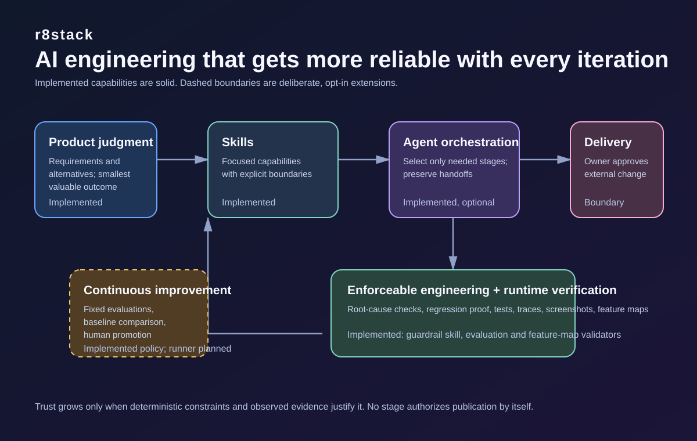
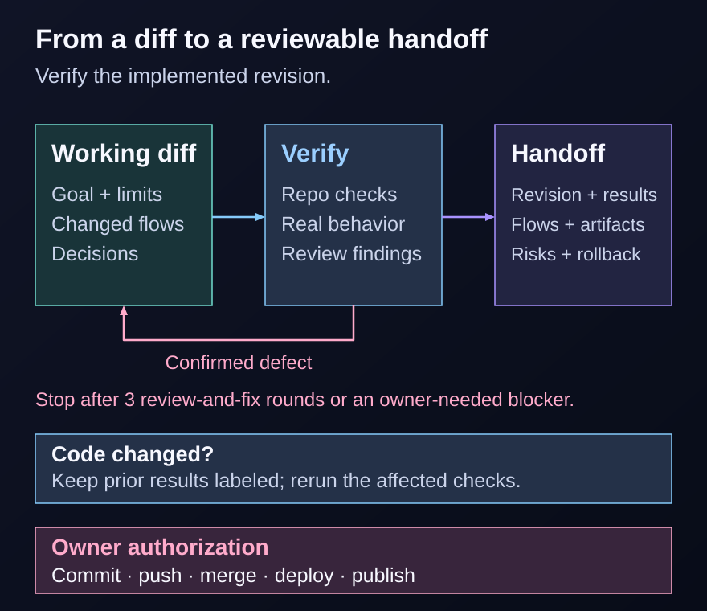
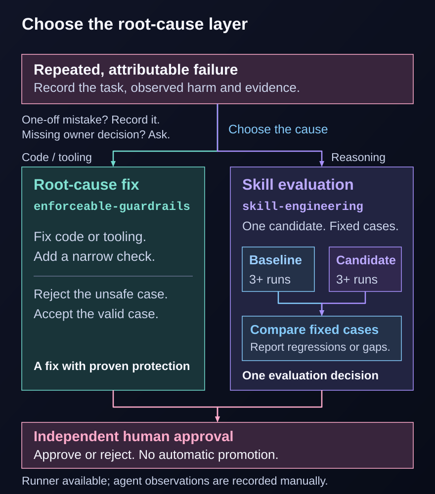
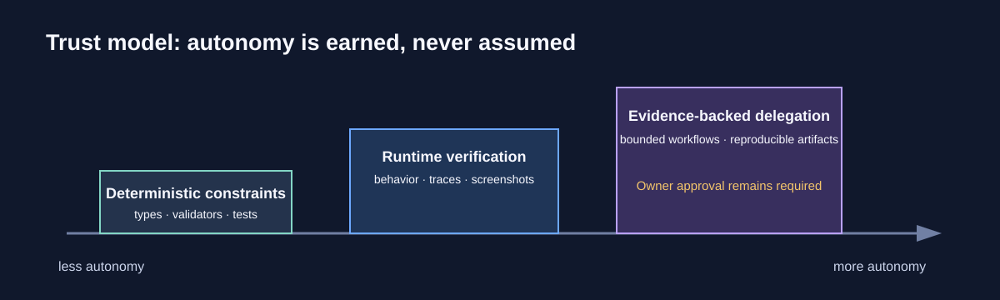

# r8stack architecture

`r8stack` is a composable engineering system. It does not run every stage for every request and does not grant agents publication authority.

## Implemented now

- **Product Judgment:** `judgment-led-delivery` scopes the outcome and alternatives.
- **Skills:** each skill is independently installable through the Agent Skills format for Codex and Claude Code.
- **Agent Orchestration:** `delivery-flow` selects explicit, necessary handoffs and is optional.
- **Enforceable Guardrails:** `enforceable-guardrails`, repository validators, and regression proof keep protections close to failures.
- **Runtime Verification:** `verified-delivery`, `verify-regression-tests`, and revision-bound feature maps preserve actual evidence.
- **Continuous Improvement:** `skill-engineering` requires repeatable evidence, fixed evaluations, comparison, and human approval.

## Planned, intentionally not implied as active

The catalog includes an opt-in comparison runner for fixed, repeated evaluation observations. Provider-specific agents are intentionally not automated or enabled: an adapter must preserve complete transcripts, fixtures, and settings before it can supply trusted observations to the runner.

