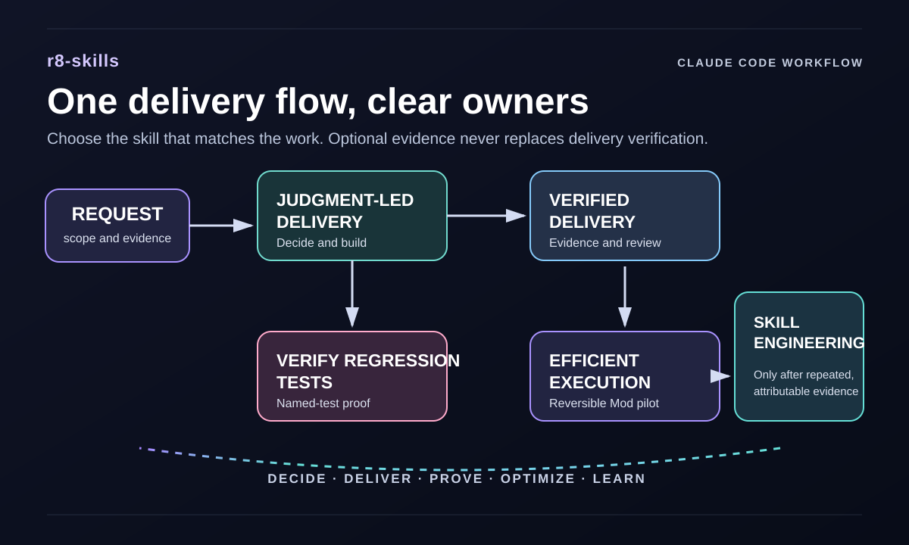
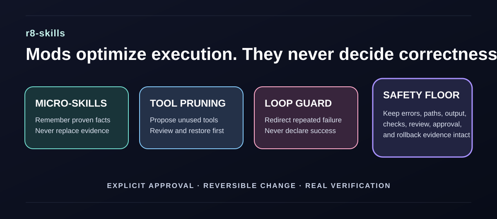

# Claude execution workflow

This is the operating flow for the r8 skill collection when used with Claude Code. It connects product delivery, verification, regression-test proof, execution efficiency, and measured skill improvement without turning them into an automatic loop.

## The flow



These are not mandatory consecutive stages. Start with the skill matching the request. `verify-regression-tests` is optional and only proves a named test. `efficient-execution` is optional and only evaluates an optimization. `skill-engineering` begins only when repeated attributable evidence justifies changing instructions.

## Invocation and evaluation model

Skills do **not** call themselves or one another. Invoke the relevant skill explicitly in the Claude Code prompt; this keeps the task owner in control of cost, scope, and review depth. `delivery-flow` can select the next stage and prepare its prompt plus a handoff record, but it cannot load or run that stage. The examples in each skill README show a representative invocation, and every skill has `evals/evals.json` with positive routing prompts, negative routing prompts, behavior-focused cases, and an overlap decision.

Those evaluations are catalog checks, not a live proof that Claude followed the skill on this machine. Use the repository's actual commands and `verified-delivery` for delivery evidence.

Mods are different: once installed and enabled, their hooks can run automatically at the host events they subscribe to. That automatic behavior is why they need a narrower safety boundary and a real compatibility check before they are trusted.

## Responsibility boundaries

| Concern | Owner | It must not do |
| --- | --- | --- |
| Product scope and user journey | `judgment-led-delivery` | Treat a passing engineering check as product readiness or publish work |
| Risk-sensitive delivery evidence and review | `verified-delivery` | Reopen settled product scope or merge/deploy automatically |
| Whether one named test catches its claimed bug | `verify-regression-tests` | Substitute for broader test or release verification |
| Cost, context, handoff, tool, or loop optimization | `efficient-execution` | Reduce required evidence, model capability, review, or approval |
| Revision of a skill from recurring evidence | `skill-engineering` | Automatically change, approve, or publish a skill |
| Explicit cross-skill handoff and next-stage prompt | `delivery-flow` | Load or run another skill automatically |

## Claude Code Mods: allowed role

Mods optimize execution; they do not decide correctness. The currently observed TokenEconomizer installation provides three relevant mechanisms:



| Mod mechanism | Use it for | Guardrail |
| --- | --- | --- |
| Micro-skills | Remembering proven repository facts between sessions | Facts must be attributable and must not replace repository instructions, current test output, or a handoff |
| Tool pruning | Removing demonstrably unused tool definitions | Start in proposal mode; review the exact tools and confirm the restore path before it writes configuration |
| Loop guard | Redirecting a turn that repeats unproductive edits and failures | It may suggest a materially different next step; it cannot declare the task fixed, hide the failure, or stop required verification |

Model routing, effort routing, browser-payload reduction, cache management, and automatic handoffs are **not enabled by this catalog or by this workflow**. They are candidates to evaluate through `efficient-execution`, not promises or default behavior.

## Native host evolution

This workflow is intentionally host-agnostic. If Codex later provides a native equivalent to a Mod mechanism, reevaluate the external plugin before continuing to rely on it. Prefer the native capability when it preserves the same safety floor, exposes the needed evidence and controls, and can be verified on the current host version. Update this guide with the observed behavior, compatibility result, migration or rollback path, and any remaining reason to keep an external Mod; do not assume that a native feature is automatically safer or equivalent.

## Mod compatibility record

Do not commit one machine's plugin state, host version, or test result as catalog truth. Record each pilot outside this catalog or in a dated compatibility record that identifies the plugin and host versions, mechanisms enabled, test scope, evidence, failures, rollback command, and reviewer. Treat every new host or plugin version as unverified until the same reversible pilot is repeated.

## Non-negotiable safety floor

No Mod may remove or distort:

- exact error messages, stack traces, file paths, line numbers, tool output, or changed-file information;
- decisions, assumptions, unresolved blockers, acceptance criteria, or ownership;
- verification commands, their exit status, or whether evidence was run now versus reported earlier;
- required review depth, model capability, human approval, authorization checks, or rollback analysis for high-risk work.

If a summary or handoff cannot retain that state, classify it as incomplete and recover the source evidence before continuing.

## Recommended Claude Code usage

1. Start ordinary feature work with `judgment-led-delivery` when product or user-journey judgment is needed. For a narrow engineering fix, use the repository's focused implementation and testing guidance instead.
2. Once a diff exists, invoke `verified-delivery` to collect real evidence and review it. It owns the maximum of three review-and-fix rounds.
3. If a critical regression test is added or changed, invoke `verify-regression-tests` separately and record its working → broken → restored proof as delivery evidence.
4. Before trying a Mod or changing its configuration, invoke `efficient-execution`. Establish a fixed baseline and a small reversible pilot; compare quality and verification before cost.
5. Only after repeated, similar failures should `skill-engineering` assess whether a skill revision is preferable to a code, test, tool, or architecture fix.

Example prompts:

```text
Use judgment-led-delivery to implement the requested settings flow using existing patterns.
Use verified-delivery to verify the current diff before review. Do not merge.
Use verify-regression-tests to prove that the named invitation test catches rejected invitations.
Use efficient-execution to assess TokenEconomizer's tool-pruning proposal. Do not apply it.
Use skill-engineering to evaluate the recurring evidence; do not revise any skill yet.
```

## Stop conditions

- `verified-delivery` stops after evidence supports a verdict, a blocker needs an owner, or three review-and-fix rounds are complete.
- `verify-regression-tests` stops with caught, missed, inconclusive, or untestable evidence for the named test.
- `efficient-execution` stops with a recommendation, rejection, or incomplete evidence; it never installs, enables, or updates a Mod without approval.
- `skill-engineering` stops after one proposal and one evaluation decision. Another cycle requires new evidence.

The flow intentionally prevents a builder, a reviewer, a Mod, and a skill improver from creating an endless automated repair cycle.
