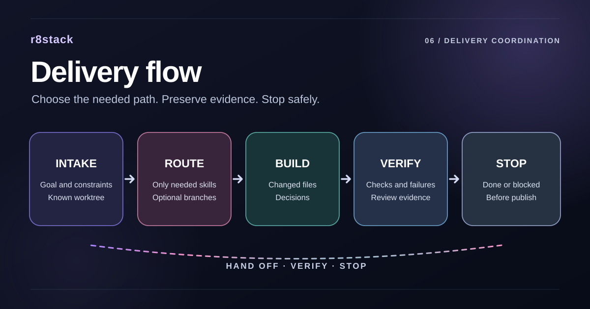

# Delivery flow



**One entry point for a bounded, evidence-preserving delivery workflow.**

`delivery-flow` selects the appropriate stages for an explicitly requested task. It is a state machine, not a fixed five-step loop: a narrow bug skips product discovery, a named test-proof request skips implementation, and a Mod evaluation does not install anything.

## Install this skill

Install **only delivery-flow** globally for Codex and Claude Code:

```bash
npx skills add rafa-ochoa/r8stack --skill delivery-flow -g -a codex -a claude-code -y
```

Requires Node.js 22.20 or later. Remove `-g` for a project-only install. To install the entire collection, see the [main README](../../README.md#install-the-collection).

## Use it

Invoke it explicitly when you want one coordinated workflow:

> Use delivery-flow to implement the account-recovery feature. Preserve the existing uncommitted work, verify the resulting diff, and stop before merge.

It records the goal, decisions, changed files, checks, failures, blockers, and next action at each handoff. It prepares the next explicit skill prompt; it does not load or run other skills automatically. It never treats a passing check as authorization to publish, merge, deploy, install, or enable a Mod.

## Routes

| Request | Route | Stop |
| --- | --- | --- |
| Clear feature | Build with `judgment-led-delivery`, then verify with `verified-delivery` | Review-ready evidence, before merge |
| Narrow bug fix | Build with repository guidance, then verify | Verified fix or a blocker |
| Named test proof | `verify-regression-tests` | Caught, missed, inconclusive, or untestable |
| Mod or efficiency evaluation | `efficient-execution` | Recommendation, rejection, or evidence gap; no configuration changes |
| Evidence for revising a skill | `skill-engineering` | One proposal, rejection, or inconclusive decision |

For the full state and transition contract, read the [delivery-flow acceptance criteria](../../docs/delivery-flow-spec.md). The skill allows at most three review-and-fix rounds and stops for owner decisions and approval boundaries.

## Expected result

The result leads with the current outcome and includes the evidence actually gathered, not an invented checklist. It separates checks run now from earlier reports and inspection, records unresolved risk, and identifies an owner only when the next step needs one.

## Read more

- [Skill instructions](SKILL.md)
- [Evaluation cases](evals/evals.json)
- [Claude execution workflow](../../docs/claude-execution-workflow.md)
