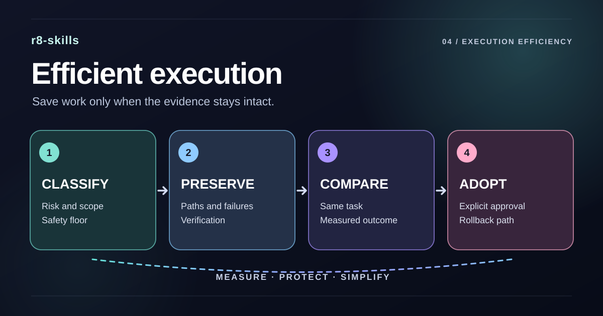

# Efficient execution

**Make coding agents cheaper only when the work stays equally trustworthy.**

Use this skill to assess context compression, model or effort routing, session handoffs, browser-payload reduction, caching, or loop-control plugins. It is deliberately a decision and evaluation skill, not an installer: a Mod can inspect or change sensitive execution state, so installation and activation require explicit authorization after source review.

## Example

> Use efficient-execution to evaluate whether our installed TokenEconomizer plugin can reduce routine test-triage cost. Do not enable or change it. Preserve complete failures, paths, and verification evidence, and recommend a reversible pilot only if we can measure equivalent outcomes.

## Relationship to the collection

- Use `judgment-led-delivery` to decide and deliver a product outcome.
- Use `verified-delivery` to prepare an implemented change for review.
- Use `verify-regression-tests` to prove that a named test catches the behavior it protects.
- Use this skill only to make those workflows more efficient without reducing their safety floor.

## Integrating a Mod

1. Inspect its manifest, source, supported host versions, tests, permissions, data flow, and disable path.
2. Define a fixed baseline and a small representative task set before changing any configuration.
3. Run an opt-in, reversible pilot. Keep the same acceptance criteria and repository verification commands.
4. Compare completion quality and required evidence first; then compare measured latency and available usage data.
5. Ask for explicit approval before installing, enabling, authenticating, or updating it.

Passing plugin tests only establishes the behavior covered by those tests. It does not prove security, compatibility, cost savings, or safe operation in a particular repository.
