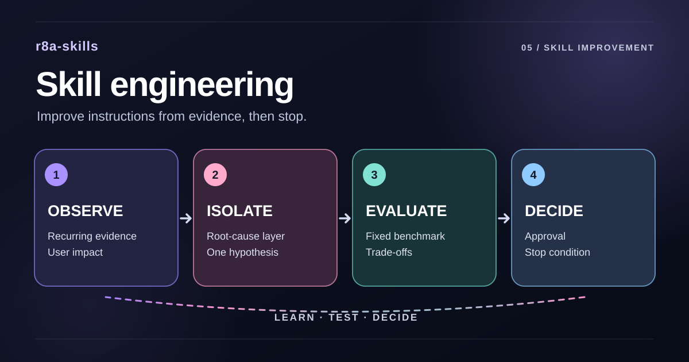

# Skill engineering

**Improve an agent skill only when recurring evidence shows that instructions are the right layer to change.**

This skill prevents a self-improvement loop from becoming uncontrolled. It turns repeated delivery failures into one bounded hypothesis, evaluates the candidate against fixed criteria, and requires approval before any promotion.

## Example

> Use skill-engineering to assess whether repeated agents are treating yesterday's CI as a fresh test pass. Do not change any skill yet. Determine whether the root cause belongs in code, tooling, or instructions; if instructions are justified, propose one narrow revision and a fixed evaluation plan.

## Outcome

The result is a proposal, rejection, or inconclusive decision. It never automatically edits, installs, enables, publishes, or promotes a skill.
