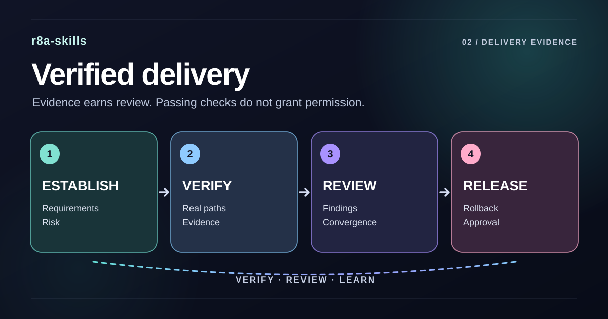

# Verified delivery



**Prove a change works before asking someone to merge it.**

Verified delivery takes an implemented diff through proportionate verification, independent review, bounded convergence, and review-ready reporting. It is designed for any project, including sensitive flows such as private content, sharing permissions, and migrations.

It complements [Judgment-led delivery](../judgment-led-delivery/README.md): use Judgment-led delivery to decide and build a useful user outcome; use Verified delivery afterward to establish whether the resulting implementation is safe and ready for review.

## What it does

| Stage | Agent focus |
| --- | --- |
| Establish | Map requirements, changed paths, regressions, and risk. |
| Verify | Run relevant checks through real behavior. Compare the baseline and candidate using the same checks when applicable. |
| Review | Validate independent findings, fix only justified issues, and stop after at most three rounds. |
| Handoff | Link each material criterion to the relevant diff and evidence. Record gaps, risks, rollback readiness, and any approval needed. |

The workflow is risk-sensitive, not a mandatory ceremony. Routine low-risk edits stay lightweight. Sensitive data, permissions, payments, migrations, destructive operations, and hard-to-reverse deployments get deeper verification and explicit human approval before merge.

## Install this skill

Install **only verified-delivery** globally for Codex and Claude Code:

```bash
npx skills add rafa-ochoa/r8stack --skill verified-delivery -g -a codex -a claude-code -y
```

Requires Node.js 22.20 or later. Remove `-g` for a project-only install. To install the entire collection, see the [main README](../../README.md#install-the-collection).

Already installed? Update this skill globally with `npx skills update verified-delivery -g -y`.

## Use it

Invoke it after implementation, or on a pull request/diff that needs evidence:

> Use verified-delivery to verify this private-content sharing change before review. Check authorization, inspect the migration and rollback path, run the relevant tests, and do not merge.

In Codex, you can explicitly start with `$verified-delivery`. The agent should give one evidence-backed verdict—**ready for review**, **not ready**, or **verification incomplete**—and should never merge, deploy, or claim a check passed without authorization and evidence.

## Read more

- [Skill instructions](SKILL.md)
- [Verification evidence](references/verification-evidence.md)
- [Review convergence](references/review-convergence.md)
- [Risk and release](references/risk-and-release.md)
- [PR readiness](references/pr-readiness.md)
- [Evals](evals/evals.json)

## Inspiration

The workflow is informed by Anthropic's [*Solving code review at Anthropic*](https://www.anthropic.com/engineering/solving-code-review-at-anthropic), adapted to remain project-agnostic, evidence-led, and explicitly human-authorized for risky actions.
