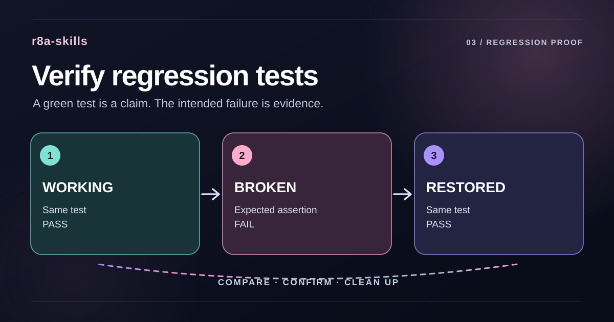

# Verify regression tests



**Prove a regression test detects the behavior it claims to protect.**

`verify-regression-tests` compares one unchanged regression test against working, faithfully known-bad, and restored behavior. It requires the expected assertion failure—not merely any failure—before calling the test proven.

It does not replace feature implementation, test-first development, or release verification. It proves the sensitivity of tests that already exist or have just been changed.

## Install

Install this skill for Codex and Claude Code:

```bash
npx skills add rafa-ochoa/r8a-skills --skill verify-regression-tests -g -a codex -a claude-code -y
```

Remove `-g` for a project-only installation. Already installed? Update it with:

```bash
npx skills update verify-regression-tests -g -y
```

## Use

> Use verify-regression-tests to prove the new save-error test detects a failed persistence call. Work in a scratch copy and do not modify the production checkout.

> Review these checkout tests with verify-regression-tests. Find project-owned mocks, then prove the remaining assertions detect the important failures.

## What you get

Each reported behavior is classified as caught, missed, inconclusive, or untestable. The report records the safe sabotage and the assertion-level evidence, rather than simply counting green tests or coverage.

## Read more

- [Skill instructions](SKILL.md)
- [Comparison proof](references/comparison-proof.md)
- [Evaluations](evals/evals.json)
